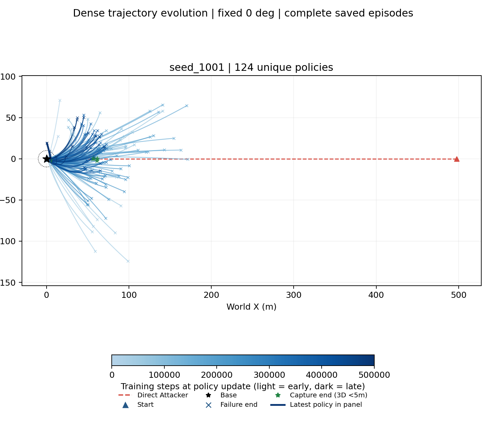
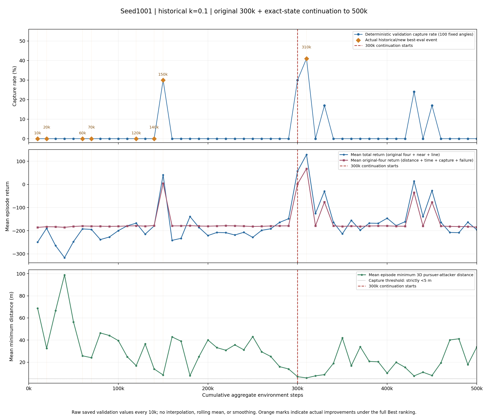
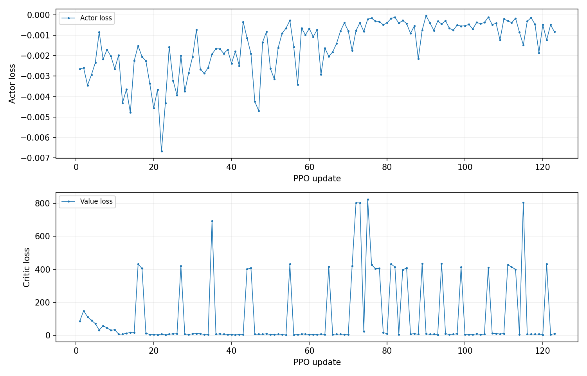

# 多无人机协同拦截强化学习

**Multi-UAV Interception with Multi-Agent Reinforcement Learning**

毕业设计《基于多智能体强化学习的多无人机拦截策略研究》的实验工程。研究三架拦截无人机如何保护固定基地，阻止一架来袭无人机进入攻击区域。

仓库包含 **3A1C MAPPO参考系统**，以及用于排查奖励、探索噪声、策略退化和方向泛化问题的独立 **1v1 PPO实验系统**。当前已跑通环境、训练、恢复、评估与可视化流程；跨Seed稳定训练出高成功率策略仍是待解决的问题。

## 实现内容

- 三维质点动力学，包含速度、加速度和jerk约束；物理参数由YAML管理。
- 以基地为目标的规则型Direct Attacker，不主动规避。
- 3A1C共享Actor、团队奖励与集中式Critic的MAPPO参考实现。
- 独立1v1 PPO：8环境采样、GAE、Tanh Gaussian、解析KL早停和线性学习率衰减。
- 完整Checkpoint恢复，包含优化器、Scheduler、RNG、环境及未完成Rollout。
- 固定验证角度、冻结模型方向测试、奖励离线重放和多Seed受控对照。
- Reward、Loss、std、KL等曲线，以及逐Checkpoint轨迹演化、三维轨迹和完整回合视频。

## 两条实验线

| 项目 | 3A1C MAPPO参考 | 当前1v1 PPO受控实验 |
| --- | --- | --- |
| 目的 | 建立多机协同拦截参考系统 | 先核实单机交会与训练稳定性，再回到多机问题 |
| 我方 / 敌方 | 3 / 1 | 1 / 1，保留原中线P0 |
| Actor输入 | 21维局部观测 | 16维固定物理尺度观测 |
| Critic输入 | 24维全局状态 | 与Actor相同的16维观测 |
| 网络 | 共享Actor；集中式Critic | 独立Actor/Critic，均为128×128 Tanh |
| 动作 | 每架我方机3维加速度指令 | 3维加速度指令 |
| 环境入口 | [PursuitEnv](envs/pursuit_env.py) | [InterceptionEnv](envs/interception_env.py) |
| 算法入口 | [MAPPO](algorithms/mappo/mappo.py) | [PPO](algorithms/ppo/agent.py) |

单机结果不作为三机协同成功的证据。MAPPO参考通过共享奖励、集中式价值估计和参数共享隐式学习协同，尚未实现显式通信或角色分工。

## 当前1v1任务设置

基地为`[0,0,0]`，我方初始位置为`[1.5,0,1]`，双方初速度为零。敌机初始三维距离基地500m、高度50m，每回合绕基地采样来袭角度`U(−30°, +30°)`；0°沿+X，正角逆时针。敌机持续直接飞向基地。

双方水平速度上限20m/s、爬升/下降上限8/6m/s，水平/垂直加速度上限3/2m/s²，三维jerk上限5m/s³。步长0.1s，最长50s。

- 敌我三维距离严格小于5m：捕获成功并终止。
- 否则，敌机到基地距离严格小于10m：防御失败并终止。
- 捕获优先；50s超时也视为真正终止。

16维观测依次为自身速度、applied acceleration、敌我相对位置、相对速度、敌机相对基地位置、剩余时间比例。采用固定除数归一化，不动态中心化或静默截断。完整定义见[单机环境配置](configs/interception_1v1.yaml)与[正式训练规范](FORMAL_TRAINING_SPEC_V1.md)。

## 代表性结果与失败模式

以下为 **v16、Seed1001、线段成本k=0.1** 的历史诊断。同一Seed从300k继续训练到500k，保留原优化器与学习率履历；Best按固定验证集的任务指标选择，不按Reward选。

| 模型 / 测试范围 | 捕获次数 | 捕获率 |
| --- | ---: | ---: |
| 300k Final，原±30°配对500场景 | 165 / 500 | 33.0% |
| 310k Best，同一±30°500场景 | 233 / 500 | **46.6%** |
| 500k Final，同一±30°500场景 | 0 / 500 | 0% |
| 冻结310k Best，新采样的[−29°, −5°]500场景 | 500 / 500 | **100%（仅该角域）** |

这一结果反映了明显的方向偏置和后续PPO更新丢失成功能力。局部100%来自已选定的负角扇区，其余初态固定，不能外推到整个±30°或任意来袭方向。原500场景后来参与过奖励离线标定，因此这里用于配对诊断，不作为最终独立泛化结论。其他Seed尚未呈现一致改善。

### 轨迹如何随训练变化

下图覆盖0–500k的124个真实策略时点；各Checkpoint在同一个固定0°场景下进行确定性完整回合，颜色从早期到后期逐渐加深。它展示策略变化，不代表整个角度分布的捕获率。



### Reward和验证捕获率

下图使用真实训练/验证记录，标明300k续训分界。奖励改善与最终捕获能力没有保持一致，不能单凭总Reward判断策略是否更好。



### Actor和Critic Loss

下图按PPO update展示原始Loss。数值稳定性、验证任务指标和轨迹行为需要一起检查，Loss下降不等于学会拦截。



三张图均为现有真实图像的原字节副本，没有重新平滑或重绘。[图像来源与SHA说明](docs/assets/README.md)保留了实验范围。

## 实验版本

| 版本 | 研究变化 | 已完成训练 |
| --- | --- | --- |
| v01–v13 | 3A1C参考、奖励/归一化对照、方向课程、学习率与探索噪声诊断 | 见[历史实验索引](experiments/EXPERIMENT_INDEX.md) |
| v14 | 独立1v1 PPO，原距离/时间成本与捕获/失守终端奖励 | 5个Seed，300k→500k |
| v15 | 新增历史最小距离near shaping，λ20m、β100 | 3个Seed，各300k |
| v16 | 保留near，加入三维基地—敌机闭线段成本k=0.1 | 3个Seed各300k；Seed1001续至500k |
| v17 | 主动接近归因near、k=0.01，比较β100/200 | 两组各3个Seed，各300k |

v17相对v16同时改变near归因和k，不能将历史差异归因于单一因素。版本号表示研究方案，续训属于同一run；最新版本不代表性能最好。

## 快速开始

以下命令在仓库根目录执行。依赖见[requirements.txt](requirements.txt)；当前工程以CPU运行验证为主。

发布前已在不含本地模型和历史`outputs/`的源码副本中完成验收：**1216 tests passed**（2026-11-20）。

```powershell
git clone https://github.com/zhining-chen5382/multi-uav-interception.git
cd multi-uav-interception
python -m venv .venv
.\.venv\Scripts\Activate.ps1
python -m pip install -r requirements.txt
```

Linux/macOS可将激活命令替换为`source .venv/bin/activate`。

运行测试、检查正式配置和执行一回合3A1C随机策略：

```powershell
python -c "from pathlib import Path; Path('outputs').mkdir(exist_ok=True)"
python -m pytest -q --basetemp outputs/_pytest_tmp
python -m scripts.run_formal_experiment --check-config
python -m scripts.random_rollout --config configs/baseline_3a1c.yaml --episodes 1 --seed 0
```

短程1v1 PPO检查可只收集4096 aggregate steps，即8环境×512步并完成一次PPO update，随后保存暂停Checkpoint：

```powershell
python -m scripts.train_formal_ppo --config configs/ppo_formal_v1.yaml --seed 1001 --stop-at-steps 4096 --output-dir outputs/demo_ppo_4096
```

这条命令不会执行完整300k训练。重复运行时使用新的输出目录。正式五Seed入口默认预算为每Seed300k，应先阅读[训练规范](FORMAL_TRAINING_SPEC_V1.md)并显式规划独立输出位置。

## 代码结构

```text
envs/                  三维环境、动力学、攻击机策略、奖励几何
algorithms/mappo/      3A1C共享Actor与集中式Critic参考
algorithms/ppo/        独立单机PPO、GAE与动作分布
configs/               环境、训练、评估、离线标定参数
scripts/               训练、恢复、评估、制图与实验索引入口
utils/                 采样、报告、路径与可视化模块
tests/                 环境/概率/PPO/恢复/评估专项测试
experiments/           技术报告、实验索引和版本记录
docs/assets/           精选真实图像与来源说明
outputs/               本地生成数据，不纳入Git
```

## 文档与复现范围

- [3A1C Baseline规格及历史兼容](BASELINE_SPEC.md)
- [1v1正式训练规范](FORMAL_TRAINING_SPEC_V1.md)
- [全部实验版本、运行与模型登记](experiments/EXPERIMENT_INDEX.md)
- [5-Seed原奖励500k结果](experiments/FORMAL_PPO_V1_500K_RESULTS.md)
- [主动near配比结果与失败分析](experiments/ACTIVE_NEAR_BETA_AB_300K_REPORT.md)
- [目录和图表导航说明](experiments/FORMAL_OUTPUT_ORGANIZATION_20261120.md)

本仓库公开源代码、配置、测试、研究报告及少量精选图像。完整模型权重、训练输出、逐回合轨迹与视频保存在本地`outputs/`，不随Git发布；历史报告中的`outputs/`链接对应本地实验产物。复现实验需要自行从零训练，评估脚本需要相应Checkpoint。

完成实验后可从本地`outputs/formal_ppo_v1/00_实验总览.html`查看版本、Reward、Loss、轨迹与视频；仅克隆代码时尚不存在此页面。

## 当前边界

当前使用受约束质点模型，没有完整四旋翼姿态、地面接触、障碍物或传感器噪声。Direct Attacker不主动规避，已有结果不能证明对机动敌机的泛化能力。接触按离散时刻三维距离判断；三维捕获不能由XY投影是否重叠替代。

接下来优先解决成功策略保持、正负来袭方向偏置及跨Seed可重复性，再验证显式多机协同和更复杂来袭策略。
